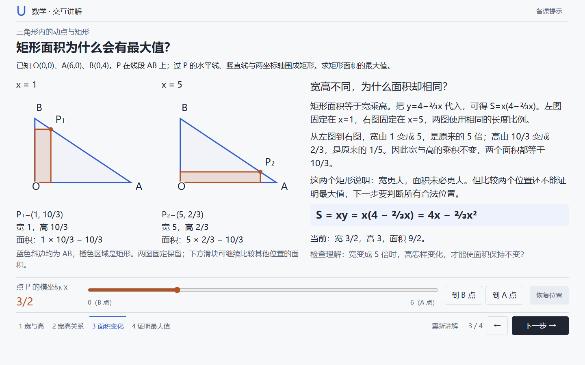
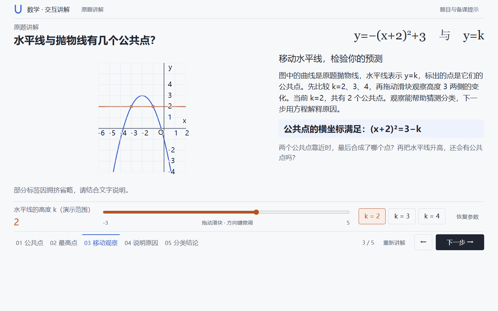

# Math Visualizer · 数学单题可视化

**给 AI 一张数学题截图，生成老师可操作的可视化讲解。**

支持题目截图、照片或文字输入。生成的课件可分步讲解、调节参数，保存为单文件 HTML，浏览器打开即可离线使用。适合用简短文字讲清的题目，也会直接给出解答。

## 成品效果

**矩形面积：并排比较两个状态，解释宽高不同、面积为什么相同。**



**函数交点：拖动滑块改变水平线位置，观察交点个数，再解释原因。**



以上为实际生成课件的截图。

## 安装

把下面这句话发给支持 Skill 安装的 AI Agent：

```text
帮我安装这个 Skill：https://github.com/TruthBug/math-visualizer
```

## 使用

上传题目截图，然后说：

```text
用 math-visualizer 把这道题做成可视化讲解。
```

也可以直接粘贴题目文字。想调整成品，继续说：

```text
这一步没讲明白，请加一张对照图，解释为什么。
```

生成后，用浏览器打开 HTML 即可演示；老师控制推进节奏，可随时返回上一步或恢复参数。

## 更多说明

[环境与手动构建](docs/usage.md) · [配置示例](skills/math-visualizer/references/examples.md) · [架构与扩展](docs/architecture.md)

## 许可

原创代码与文档采用 [MIT](LICENSE)。第三方试题材料保留其原有[来源与许可](skills/math-visualizer/assets/examples/SOURCES.md)。
